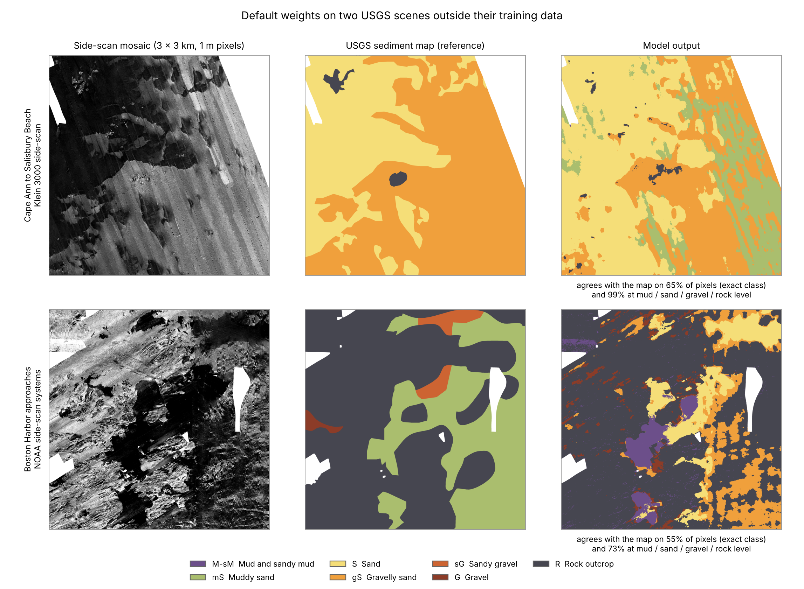
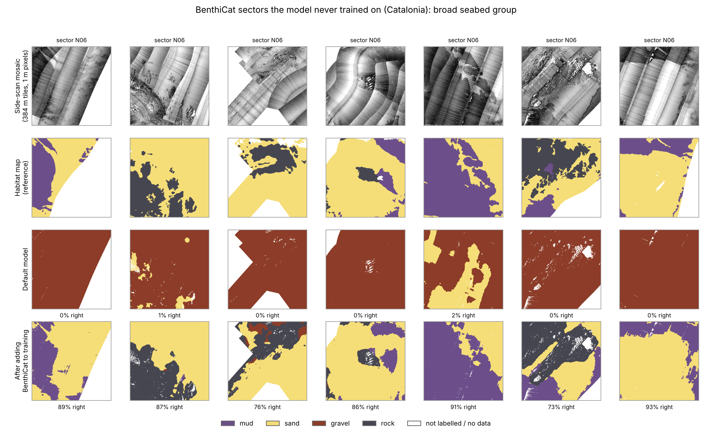
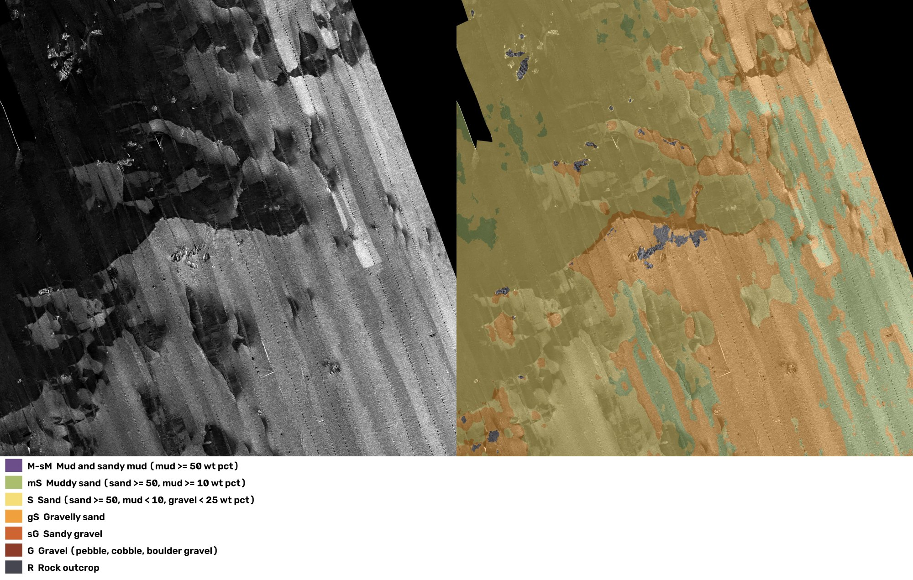
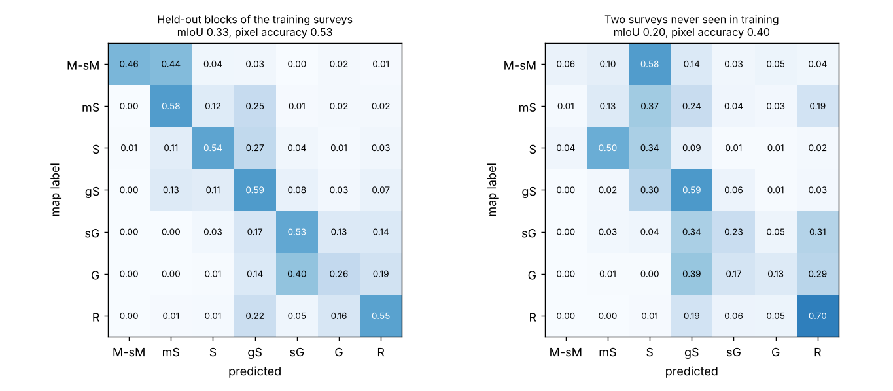
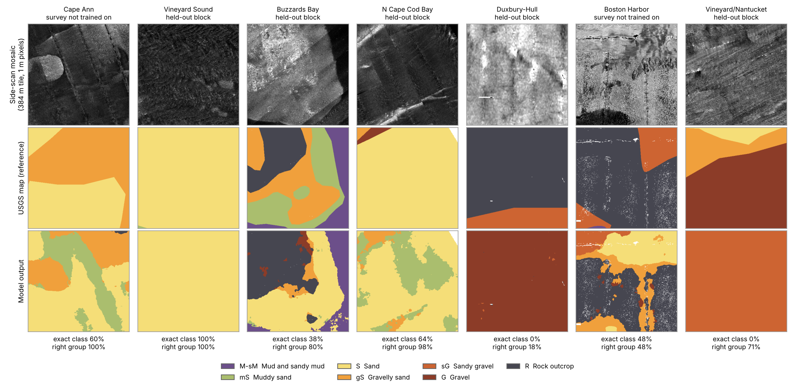
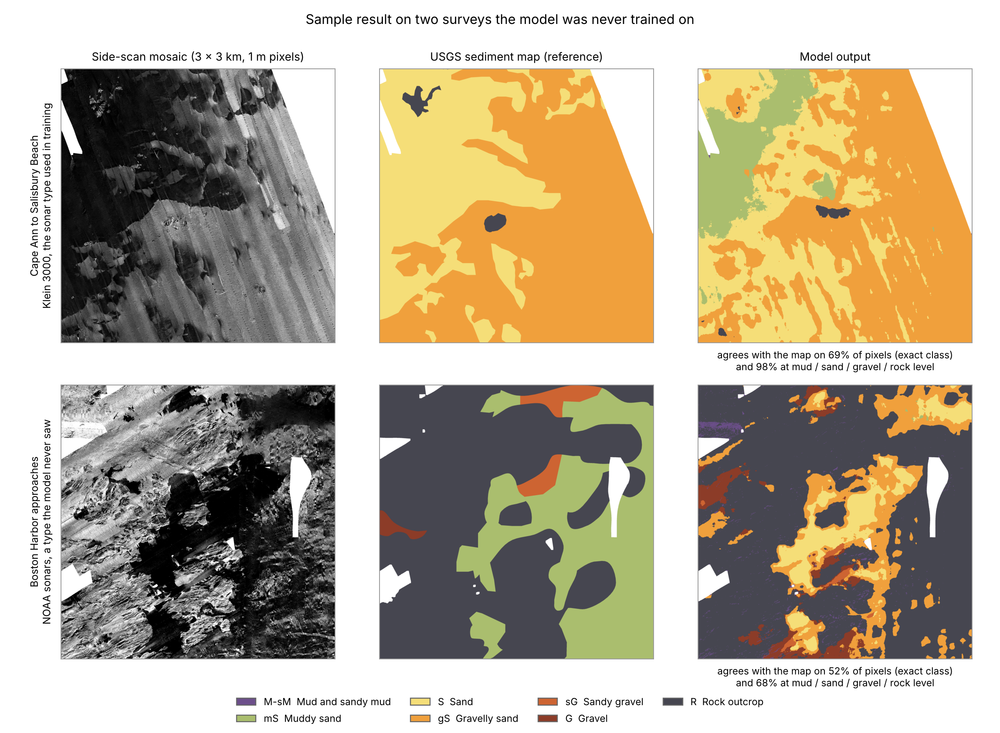
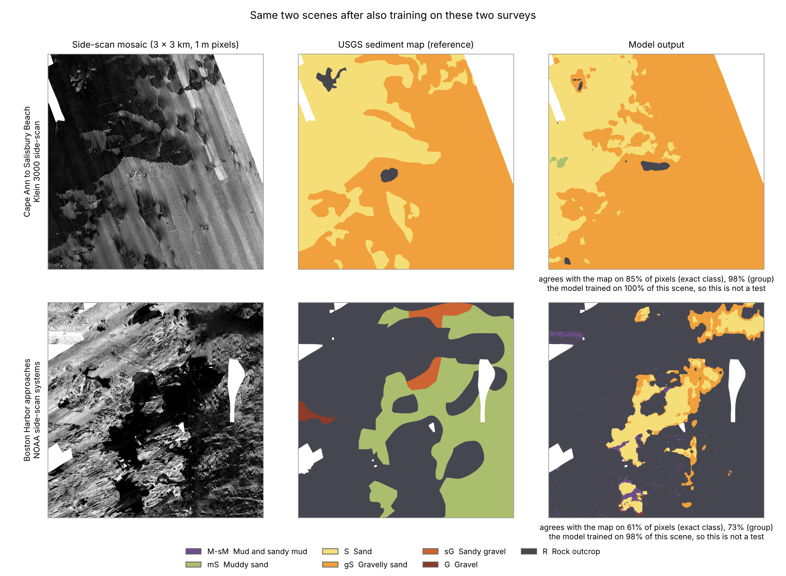
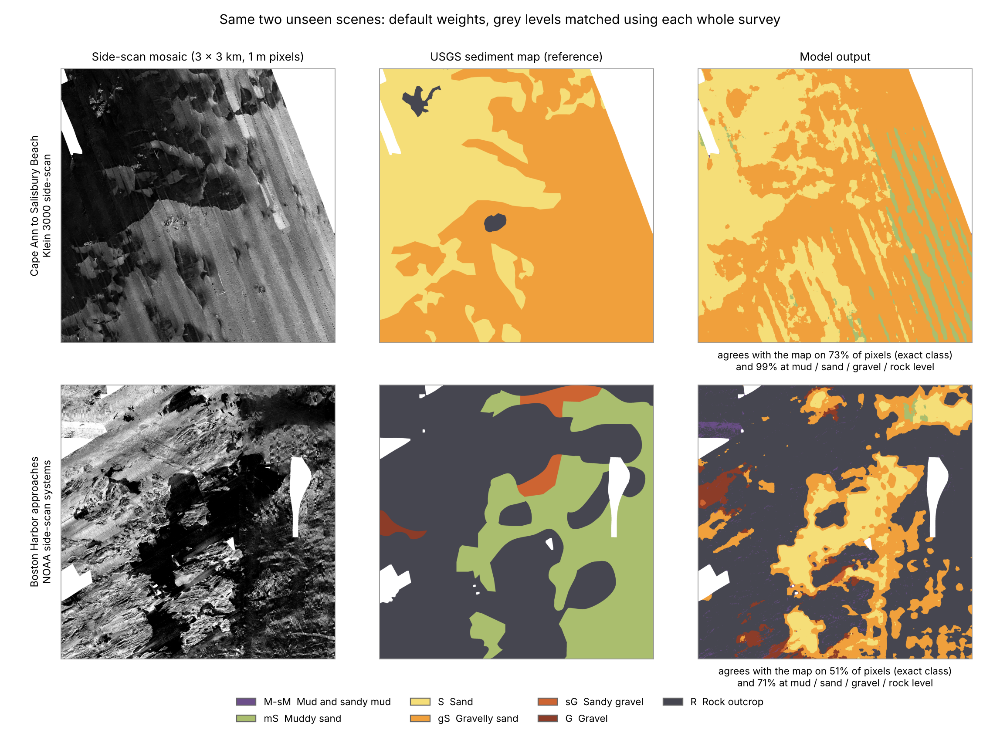
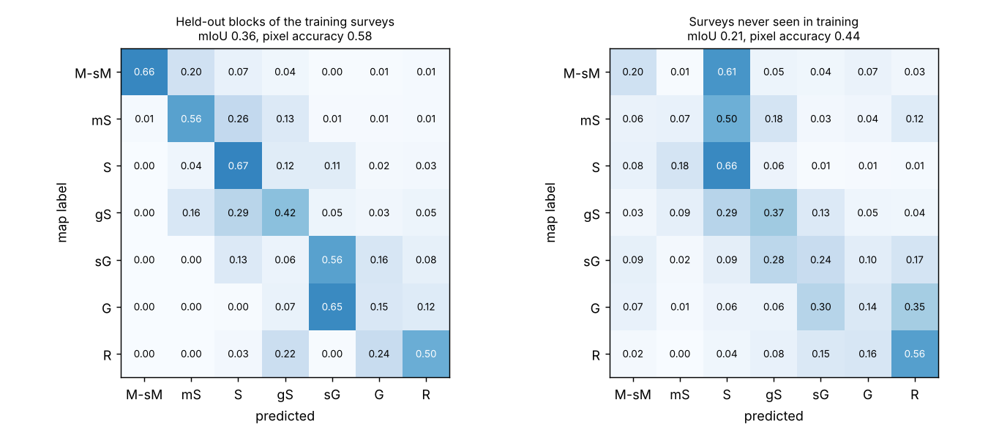

# Seabed substrate segmentation for side-scan sonar

A [segmentation_models_pytorch](https://smp.readthedocs.io) model that labels every pixel of a
side-scan sonar mosaic with a sediment class from Valentine (2019),
[USGS Scientific Investigations Report 2019-5073](https://doi.org/10.3133/sir20195073).

**Status: a usable first-pass map, not a finished interpretation.** The recommended weights
(`models/seabed_valentine7_joint.pt`, used by default) were trained on five USGS surveys from
Massachusetts and five sectors of the BenthiCat data set from Catalonia, about 70 minutes on a
4-core CPU in all.

| Tested on | Right group (mud / sand / gravel / rock) | Exact class (7) |
|---|---|---|
| Held-out blocks of the five USGS training surveys | 75 % | 58 % |
| Boston Harbor, a USGS survey never trained on | 51 % | 34 % |
| Two BenthiCat sectors never trained on | 72 % | not measurable there |

Before BenthiCat was added, the model scored 9 % right group on those BenthiCat sectors, so
do not expect it to work unaided on a survey unlike both training sets. Check the output
against ground truth, and if you have any labels of your own, fine-tune (see below).

## Example results

All three figures use the default weights.

**Two USGS scenes outside the training data** (3 × 3 km each): the sonar mosaic, the USGS
sediment map used as the reference, and the model's output.



In the Cape Ann scene the model agrees with the map on 65 % of pixels at exact-class level and
99 % at mud / sand / gravel / rock level. In the Boston Harbor scene it is 55 % and 73 %: rock
is found, but the muddy sand in the middle is called sand, gravelly sand or mud. Both scenes
score above their surveys' averages (63 % / 92 % for Cape Ann, 34 % / 51 % for Boston Harbor).
The Cape Ann survey was used to choose the checkpoint, though never trained on; Boston Harbor
was used for neither.

**BenthiCat tiles from a sector never trained on** (Catalonia), shown at group level: sonar,
habitat-map reference, the USGS-only weights, and the default weights.



The USGS-only weights call nearly everything gravel. The default weights get 73 to 93 % of
each of these tiles right; the average over the two test sectors is 72 %.

**What `predict.py` writes:** the input beside a colour overlay with its legend (Cape Ann
scene).



## Quick start

```bash
pip install -r requirements.txt
```

```bash
python scripts/predict.py my_mosaic.tif --out predictions
```

```bash
python scripts/predict.py waterfall_images/ --pixel-size 0.25 --out predictions
```

For each input the script writes a class raster (`_classes.tif`, georeferenced if the input
is), a colour overlay with legend (`_overlay.jpg`), a bedform probability map
(`_bedforms.png`) and a JSON summary of class shares. Overlapping windows are blended so the
map has no square seams; rasters over 60 megapixels fall back to unblended stitching to save
memory (`--blend-max-mpx`).

These settings decide whether the output means anything:

| Setting | Why it matters |
|---|---|
| `--pixel-size` | The model works at 1 m per pixel and the script resamples to that. GeoTIFFs in a projected CRS are read automatically; for plain images you must say how many metres one pixel covers (two values if across-track and along-track differ). |
| `--invert` | Training mosaics show strong returns as bright. Use this flag if yours show them dark. |
| `--match-tones` | For a survey the model was not trained on: remaps grey levels to the training data's distribution. Give it the whole survey with `--tone-from all_my_mosaics/*.tif`; from one small scene it can make things worse. Worth trying, not proven, and tested only with the USGS-only weights (`--model models/seabed_valentine7.pt`); see "Adapting to a new survey without labels". |
| `--nodata` | Pixel values to ignore (default `0 255`). Water column, nadir gap and anything outside the swath should carry one of these values, otherwise they are classified as seabed. |

## Classes

The report defines sediment classes by weight percent of mud, sand and gravel (tables 6 and 7),
adds classes that can only be identified from imagery (table 9: gravel pavements, rock outcrop)
and describes substrates with a mobility prefix (`r_` rippled, `i_` immobile). The model
predicts the classes at the aggregate level that the public training data can support:

| id | Abbr. | Class | Report class |
|---|---|---|---|
| 0 | M-sM | Mud and sandy mud (mud ≥ 50 wt %) | 1 and 3 |
| 1 | mS | Muddy sand (sand ≥ 50, mud ≥ 10 wt %) | 7 |
| 2 | S | Sand (sand ≥ 50, mud < 10, gravel < 25 wt %) | 5 |
| 3 | gS | Gravelly sand | 6, 8 |
| 4 | sG | Sandy gravel | 10 |
| 5 | G | Gravel: pebble, cobble, boulder gravel | 9; pG, cG, bG |
| 6 | R | Rock outcrop | R (table 9) |

A second output gives the probability that the sediment carries bedforms, the closest
available stand-in for the report's rippled/mobile (`r_`) property.

Not predicted: the fine- versus coarse-grained sand split (`fgS`/`cgS`), the mixed classes
14 to 20, shell deposits, semiconsolidated mud and layering ("partial veneer on"). Mud (class 1)
and sandy mud (class 3) are merged because almost no training polygon has under 10 % sand.

`seabedseg/valentine.py` implements the report's rules in full, independent of the model:

```python
from seabedseg.valentine import classify_grain_size, parse_substrate
classify_grain_size(mud=12, gravel=12, fine_sand=22, coarse_sand=55)
# SedimentClass(number='7b', abbreviation='mcgS', name='Muddy, coarse-grained sand', aggregate='mS')
parse_substrate("B r_cgS / i_cbG")
# Substrate(unit='B', upper='cgS', upper_mobility='r', lower='cbG', lower_mobility='i')
```

Use it to turn your own grab-sample analyses into labels in the report's terms.

## Training data

No public side-scan data set is labelled with the report's classes, so the labels were
derived. All sources are public-domain USGS products from the Massachusetts inner shelf.

**Imagery** — seven 1 m, 8-bit side-scan backscatter mosaics (towed Klein 3000, plus NOAA
Klein/EdgeTech systems), about 1,600 km² of labelled seabed:

| Survey | Report | Sonar | Role |
|---|---|---|---|
| Vineyard Sound | OFR 2012-1006 | Klein 3000 | train / val / test blocks |
| Buzzards Bay | OFR 2012-1002 | Klein 3000 | train / val / test blocks |
| Northern Cape Cod Bay | OFR 2010-1006 | Klein 3000 | train / val / test blocks |
| Duxbury to Hull | OFR 2009-1072 | Klein 3000 | train / val / test blocks |
| Vineyard and Nantucket Sounds composite | OFR 2016-1119 | Klein 3000 + NOAA Klein 5250/T-5000 | train / val / test blocks |
| Cape Ann to Salisbury Beach | OFR 2007-1373 | Klein 3000 | **never trained on** |
| Boston Harbor and approaches | OFR 2006-1008 | NOAA EdgeTech 272-T / Klein T-5500 | **never trained on** |

**Labels** — the USGS sea-floor texture polygons for the same areas (OFR 2012-1157,
2014-1220, 2015-1153, 2016-1119). They use the Barnhardt and others (1998) units and carry
mean grain-size statistics for polygons that were sampled. Conversion to the report's classes
(`seabedseg/classes.py`):

- Mud-sand units (`M`, `Ms`, `Sm`, `S`) with samples are classified with the report's own
  weight-percent rules from the polygon's mean gravel/sand/silt/clay. Unsampled polygons use
  the crosswalk `M, Ms → M-sM`, `Sm → mS`, `S → S`.
- Gravel and rock units keep the map interpretation: `Sg → gS`, `Gs → sG`,
  `G, Gr, Gm → G`, `R, Rg, Rs, Rm → R`. The report also assigns these from imagery rather
  than from samples.
- `Sr`, `Mr`, `Mg` are left unlabelled.

How well the crosswalk holds, measured on the 493 polygons that have samples (area-weighted
agreement between the crosswalk class and the class computed from grain size):

| Map unit → class | Agreement |
|---|---|
| `Ms` → sandy mud | 88 % |
| `Sm` → muddy sand | 91 % |
| `S` → sand | 85 % |
| `M` → mud | 0 % — these polygons average 14 % sand, which the report calls sandy mud; hence the merged M-sM class |
| `Sg` → gravelly sand | 7 % |
| `Gs` → sandy gravel | 2 % |

The gravel rows are the weak point of the label set. Grab samples in `Sg` and `Gs` polygons
average only 11 % and 32 % gravel, so by weight percent most would be plain sand or gravelly
sand. The map units describe areal dominance of gravel seen in imagery, and grabs
under-recover gravel, so neither source settles it. Treat gS / sG / G as "sand with some
gravel / gravel with some sand / gravel" by area, not as verified weight-percent classes.

Tiles are 384 × 384 m. Train, validation and test tiles come from separate 3 km blocks, and
two whole surveys are held out.

## Results

The sections below follow the order of the work. Up to "Adding a second region", "default"
and "shipped" mean the USGS-only weights (`models/seabed_valentine7.pt`); the weights now used
by default are the joint ones described in that last section.

USGS-only model: SegFormer with a MiT-B0 encoder (ImageNet-pretrained, 3.7 M parameters),
trained on about 17,000 random crops, roughly two passes over the 7,554 training tiles.

| Evaluated on | Tiles | Exact class (7) | Within one class | mIoU (7) | Right group (4) | mIoU (4) |
|---|---|---|---|---|---|---|
| Validation blocks | 935 | 0.56 | 0.82 | 0.32 | 0.74 | 0.54 |
| Test blocks | 1,069 | 0.53 | 0.80 | 0.33 | 0.69 | 0.48 |
| Unseen survey: Cape Ann to Salisbury (Klein 3000) | 447 | 0.43 | 0.95 | 0.29 | 0.95 | 0.39 |
| Unseen survey: Boston Harbor (NOAA sonars) | 917 | 0.39 | 0.58 | 0.16 | 0.56 | 0.30 |
| Both unseen surveys | 1,364 | 0.40 | 0.70 | 0.20 | 0.69 | 0.36 |

"Within one class" counts a pixel as right if the prediction is the labelled class or its
neighbour on the mud-to-gravel sequence M-sM, mS, S, gS, sG, G; rock must match exactly.
The four groups are mud (M-sM), sand (mS, S, gS), gravel (sG, G) and rock. Cape Ann holds
almost only sand and gravelly sand, so its group score is easy; Boston Harbor is the hard,
honest case.

Per-class IoU:

| | M-sM | mS | S | gS | sG | G | R |
|---|---|---|---|---|---|---|---|
| Test blocks | 0.46 | 0.27 | 0.42 | 0.27 | 0.41 | 0.05 | 0.44 |
| Both unseen surveys | 0.06 | 0.05 | 0.22 | 0.28 | 0.15 | 0.03 | 0.58 |



What the confusion matrices show:

- Inside the training surveys, mistakes are mostly between neighbours: 44 % of mud pixels
  are called muddy sand, a quarter of sand is called gravelly sand, 40 % of gravel is called
  sandy gravel.
- Rock is the most dependable class and holds up on unseen surveys (IoU 0.58).
- Gravel (G) is not learned. It is 3 % of the training pixels and looks like sandy gravel or
  bouldery rock in the imagery.
- On Boston Harbor the whole sequence shifts coarser: 58 % of mud is called sand. That mosaic
  comes from different sonars with a different grey-level distribution, and the model leans
  on grey level. A few labelled patches from your own survey and a short fine-tune are the
  practical fix.

Bedform output (IoU of the "bedforms present" class): 0.48 on test blocks, 0.91 on Cape Ann,
0.17 on Boston Harbor. Only two of the four texture maps record bedforms, so this head saw
less data than the class head. Treat it as experimental.

### Compared with a simple tone and texture classifier

A gradient-boosted classifier on per-pixel grey level plus local mean and roughness at two
window sizes, scored on a subsample of the same tiles:

| Evaluated on | Exact class (7) | Within one class | mIoU (7) | Right group (4) |
|---|---|---|---|---|
| Validation blocks | 0.56 | 0.75 | 0.29 | 0.71 |
| Test blocks | 0.54 | 0.73 | 0.29 | 0.68 |
| Both unseen surveys | 0.33 | 0.56 | 0.14 | 0.52 |

Inside the training surveys the network is only a little better than this baseline (mIoU
0.33 against 0.29, and no better on exact-class accuracy). The gap is larger on unseen
surveys (group accuracy 0.69 against 0.52). The network has not yet learned much beyond tone
and local roughness.

### Why SegFormer-B0

No pretrained seabed-sediment model for side-scan was found to adapt. A search of the
Hugging Face hub turned up none, and the closest public resource, the SeafloorAI data set,
is 178 GB behind manual access approval. So the comparison was between architectures in
segmentation_models_pytorch, all starting from ImageNet encoders, under the same CPU budget:

| Model | Wall-clock training | Validation mIoU (200 tiles) |
|---|---|---|
| FPN, ResNet34 | 10 min, 1 thread | 0.17 (dropped) |
| U-Net, ResNet34 | 10 min on 1 thread + 6 min on 2 | 0.23 |
| SegFormer, MiT-B0 | 10 min on 1 thread + 6 min on 2 | 0.29 |

SegFormer-B0 runs about twice as many training steps per minute on CPU, which is what decided
it. This is a result about a 16-minute CPU budget, not about which architecture is better
with proper training; on a GPU, rerun the comparison.

Example predictions of the USGS-only weights on held-out tiles, two per survey (mosaic, map
label, model):



The same two 3 × 3 km scenes as under Example results, with the USGS-only weights:



### Longer training: better at home, worse on new surveys

The shipped model was then trained for another 42 minutes (81 in total, about 42,000 crops)
with stronger grey-level jitter (`--tone-aug 1.6`), intended to make it lean less on tone.
The result is in `models/seabed_valentine7_longer.pt`:

| Evaluated on | Measure | Shipped (39 min) | Longer (81 min) |
|---|---|---|---|
| Validation blocks | mIoU (7) | 0.32 | 0.35 |
| Test blocks | mIoU (7) | 0.33 | 0.35 |
| Test blocks | Exact class | 0.53 | 0.57 |
| Test blocks | Right group (4) | 0.69 | 0.74 |
| Both unseen surveys | mIoU (7) | 0.20 | 0.16 |
| Both unseen surveys | Exact class | 0.40 | 0.34 |
| Both unseen surveys | Right group (4) | 0.69 | 0.60 |
| Unseen: Cape Ann | Right group (4) | 0.95 | 0.83 |
| Unseen: Boston Harbor | Right group (4) | 0.56 | 0.48 |

More training on five surveys teaches the model those five surveys. The stronger jitter did
not prevent that; training time and jitter changed together, so this run cannot say which of
the two did the harm. Of these two, the 39-minute model is the better starting point because
a new survey is the expected use. Use the longer one only for imagery from the same surveys it was trained on.

Choosing between the two on the unseen surveys means those surveys are no longer a clean test
of the default: its unseen-survey scores are a slightly favourable estimate.

### Training on the two held-out surveys as well

Training on a survey is the only way to raise accuracy on it, so the two held-out surveys were
added and the effect measured. Each run continues from the default weights (learning rate
2e-4, cosine decay) and its last checkpoint is scored, with no picking between checkpoints.
Scores are exact class / right group.

| Run | Trained on | Boston Harbor, whole survey | Cape Ann, whole survey |
|---|---|---|---|
| Default | 5 surveys | 0.39 / 0.56 (unseen) | 0.43 / 0.95 (unseen) |
| Control, +10 min | same 5 | 0.32 / 0.50 (unseen) | 0.60 / 0.90 (unseen) |
| +10 min | 5 + Cape Ann | 0.27 / 0.47 (unseen) | trained on |
| +10 min | 5 + Boston Harbor | trained on | 0.61 / 0.89 (unseen) |

Held-out 3 km blocks only (areas no run trained on):

| Run | Boston Harbor blocks (90 tiles) | Cape Ann blocks (110 tiles) | Original five surveys (1,069 tiles) |
|---|---|---|---|
| Default | 0.14 / 0.31 | 0.42 / 0.98 | 0.53 / 0.69 |
| Control, +10 min on the same 5 | 0.17 / 0.35 | 0.59 / 0.93 | 0.56 / 0.72 |
| 5 + Cape Ann | 0.16 / 0.31 | 0.78 / 0.95 | not scored |
| 5 + Boston Harbor | 0.26 / 0.40 | 0.55 / 0.92 | not scored |
| All seven, +15 min | 0.28 / 0.40 | 0.77 / 0.96 | 0.54 / 0.73 |

- **Training on a survey helps the rest of that survey.** Against the control, which had the
  same extra training without the new survey, Cape Ann blocks rise from 0.59 to 0.78 exact and
  Boston Harbor blocks from 0.17 to 0.26.
- **It does not carry over to another survey.** With Cape Ann added, Boston Harbor (still
  unseen) scores 0.27 against the control's 0.32; with Boston Harbor added, Cape Ann scores
  0.61 against 0.60.
- **Boston Harbor stays poor even when trained on.** Its muddy sand, sand and mud are all dark
  and close in tone in that mosaic. Fifteen minutes of training did not separate them, and it
  is not established that the imagery allows it.
- **These are single runs.** Unseen-survey scores move by 0.05 to 0.15 between checkpoints
  (Cape Ann exact went from 0.43 to 0.60 on ten more minutes of the same data), so small
  differences in these tables carry no weight.

The all-seven weights are in `models/seabed_valentine7_all7.pt`. Over held-out blocks of all
seven surveys they score 0.54 exact and 0.72 right group, ranging from 0.77 / 0.95 on Cape Ann
to 0.28 / 0.39 on Boston Harbor (`reports/metrics_all7.json`). Use them for imagery from
these seven surveys. They were not made the default for a new survey: no unseen survey is left
to test the all-seven weights on, and every continued-training run above lowered right-group
accuracy on the surveys it had not seen. The figure shows the two sample scenes with these
weights; both scenes are now training data, so it is not a test.



### Adapting to a new survey without labels

Three things that need no labels from the new survey were tried on the two unseen surveys,
starting from the default weights. Scores are exact class / right group over each whole survey.

| Method | Boston Harbor | Cape Ann | Five training surveys, test blocks |
|---|---|---|---|
| Default, nothing extra | 0.39 / 0.56 | 0.43 / 0.95 | 0.53 / 0.69 |
| Grey-level matching from the whole survey (`--match-tones`) | 0.40 / 0.58 | 0.70 / 0.95 | 0.44 / 0.60 |
| Averaging the default and control weights | 0.37 / 0.55 | 0.48 / 0.93 | 0.55 / 0.71 |
| Averaged weights plus grey-level matching | 0.38 / 0.56 | 0.64 / 0.96 | 0.46 / 0.62 |
| Self-training on the survey's own unlabelled tiles, 8 min | 0.43 / 0.53 | 0.29 / 0.93 | not scored |

- **Grey-level matching helped both unseen surveys** (together 0.40 → 0.50 exact, 0.69 → 0.70
  group, almost all of it from Cape Ann). It remaps the survey's grey levels so their overall
  distribution matches the training data's. It is an option, not the default, for two reasons.
  It lowers accuracy on surveys the model was trained on, whose own grey scale the model has
  already learned. And it needs statistics from the whole survey: computed from one 3 × 3 km
  scene alone it did nothing for Cape Ann and cost Boston Harbor 6 points of exact accuracy.
  On the two sample scenes with whole-survey statistics the effect was small: Cape Ann
  0.69 → 0.73 exact, Boston Harbor 0.52 → 0.51 exact and 0.68 → 0.71 group (figure below).
- **Weight averaging** kept unseen-survey accuracy about where the default has it and raised
  the training surveys' test blocks by about 3 points. That is a gain for the surveys already
  covered, where the all-seven weights are the better choice anyway, so no averaged file ships.
- **Self-training did not work.** The model labels the new survey itself and trains on the
  pixels it is confident about. It drifted toward the classes it already favoured: per-class
  accuracy fell on both surveys (mIoU 0.20 → 0.16 overall), and right-group accuracy fell on
  both. With a starting model this weak, its confident guesses are too often wrong.



Ten variants have now been compared on the same two unseen surveys, so the best of these
numbers flatters whichever method it belongs to. Treat grey-level matching as worth trying on
a new survey, not as a proven gain.

### Adding a second region: BenthiCat

BenthiCat (Rajani and others, arXiv 2510.04876) has side-scan mosaics of the Catalan coast and
a 1 m habitat map. It was first used as a test, then as training data.

**As a test.** Eight sectors (2,128 tiles) were converted and the existing weights scored at
group level, the only level the habitat map supports:

| Weights | Right group on BenthiCat, all eight sectors |
|---|---|
| USGS-only default | 7 % |
| USGS-only default with grey-level matching | 12 % |
| All seven USGS surveys | 24 % |
| All seven USGS surveys with grey-level matching | 31 % |
| Always answering "sand" | 47 % |

The USGS-only model called three quarters of BenthiCat sandy gravel. These mosaics are
gain-normalised for viewing, so mud is not darker than sand as it is in the USGS mosaics, and
the grey-level cue the model had learned points the wrong way. This is the honest measure of
how the USGS-only model travels: the two "unseen" USGS surveys come from the same mapping
programme as its training data and flattered it.

**As training data.** Five sectors (N01, N03, N05, N07, N09) were added to the five USGS
training surveys and training continued from the USGS-only weights for 50 minutes
(`scripts/train_joint.py`). The habitat map only says "sands and muddy sands", so the loss
accepts either muddy sand or sand for such a pixel. The checkpoint was chosen on data kept
out of training (Cape Ann and sector N08), and scored once on data used for neither
(Boston Harbor and sectors N02 and N06):

| Scored on | USGS-only weights | Joint (chosen checkpoint, 29 min) |
|---|---|---|
| BenthiCat N02 + N06, right group | 9 % | 72 % |
| Boston Harbor (unseen), exact / right group | 0.39 / 0.56 | 0.34 / 0.51 |
| Five USGS surveys, test blocks, exact / right group | 0.53 / 0.69 | 0.58 / 0.75 |
| Cape Ann (used to choose the checkpoint), exact / right group | 0.43 / 0.95 | 0.63 / 0.92 |

On the BenthiCat test sectors the joint model finds rock 91 % of the time, mud 76 % and sand
65 % (figure under Example results). Boston Harbor is 5 points lower than with the USGS-only
weights, which is inside the 5 to 15 point swing seen between runs on that survey, so it is
neither a gain nor a clear loss. The joint weights are the default because they are the only
ones that work on both kinds of mosaic.

Confusion matrices of the joint weights on the USGS tiles:



What this does not show: seven-class accuracy on BenthiCat-like imagery (its labels cannot
test that), or performance on a third kind of survey. BenthiCat's seagrass, maerl and
detritic bottoms are unlabelled in training, so the model will call them something else.

## Limits you should know about

- **Mosaics, not raw waterfalls.** Training imagery is slant-range corrected, gain-normalised
  and mosaicked at 1 m. Raw waterfall images (water column, uncorrected slant range, strong
  across-track gain) have not been tested. Correct and mask them first, or expect poor output.
- **One region.** Everything comes from glaciated inner-shelf Massachusetts. Carbonate sand,
  seagrass, reefs or deep-water mud elsewhere are outside what the model has seen.
- **Map-scale labels.** Polygons are meant for use at 1:25,000, so boundaries are generalised
  and small outcrops inside a "sand" polygon count as errors when the model finds them.
- **Tone is relative.** Mosaics are not calibrated; each image is stretched between its 1st
  and 99th percentile. A scene that is all one substrate has nothing to be relative to and is
  the most likely to be mislabelled.
- **Two families of training data.** Five USGS surveys (four sharing one sonar and one
  processing chain) and BenthiCat. A survey processed differently from both may fail the way
  BenthiCat did before it was added.

## Fine-tuning on your own survey

This is the most direct fix for the new-sonar weakness: in the experiment above, training on
part of a survey lifted exact-class accuracy on the rest of it by 9 to 19 points.
`scripts/finetune.py` does it in one command. Give it your imagery and labels as masks,
polygons or sample stations; it holds part of your labelled seabed out, fine-tunes on the
rest, and writes a report comparing the starting and fine-tuned weights on the held-out part.

```bash
python scripts/finetune.py --images my_mosaics --masks my_masks --pixel-size 0.5 --out runs/my_survey
```

```bash
python scripts/finetune.py --images mosaic.tif --polygons seabed_map.gpkg --class-field class --out runs/my_survey
```

```bash
python scripts/finetune.py --images mosaic.tif --points stations.csv --points-crs EPSG:4326 --out runs/my_survey
```

`FINETUNE.md` has the data formats, the options and how to read the report. All three label
forms have been run end to end on two 3 × 3 km scenes with training times under half a
minute, which checks the workflow only. No full-length fine-tune on real user data has been
run, so how much labelled area is enough is not known; each run's report is the evidence for
that run.

## Retraining

```bash
bash scripts/download_data.sh
```

```bash
python scripts/build_dataset.py --config data/sources.json --out data/tiles
```

```bash
python scripts/train.py --data data/tiles --out runs/segformer_b0 --arch Segformer --encoder mit_b0 --minutes 40 --batch 8 --lr 4e-4 --eval-every-min 10
```

```bash
python scripts/evaluate.py --data data/tiles --model runs/segformer_b0/best.pt --out reports --baseline
```

The joint weights add two steps (about 11 GB of downloads; needs `pip install py7zr`):

```bash
python scripts/benthicat_prepare.py N01 N02 N03 N05 N06 N07 N08 N09
```

```bash
python scripts/train_joint.py --data data/tiles --benthicat data/benthicat --out runs/joint --minutes 50
```

These settings approximate how the USGS-only weights were made. The actual run was staged (10
minutes at batch 16 during the architecture comparison, then 6 and 28 minutes at batch 8), so
a rerun will land close to, not exactly on, the reported scores.

`--holdout` (training and evaluation) chooses which surveys are kept out, for example
`--holdout boston_harbor` or `--holdout none`; without it the split made by `build_dataset.py`
is used.

`--arch` and `--encoder` accept any segmentation_models_pytorch combination. All three scripts
take `--device` and use a GPU automatically when one is present; that path was written without
a GPU to run it on, so only the CPU path is tested. A GPU makes it practical to hold out each
survey in turn and stop training when unseen-survey accuracy peaks, which the block
validation used here does not show. `train.py` writes `last.pt` at every validation, so an interrupted run can
be continued with `--init`. With `--init` the batch-norm statistics of the starting weights
are kept (`--no-freeze-bn` to update them): re-estimating them on a small data set lowered
accuracy on its own in testing. To continue from the shipped weights use
`--init models/seabed_valentine7.pt`. `--tone-aug` (default 1) sets how
hard grey levels are jittered; higher values push the model to rely less on absolute tone.

The data set with labels in the report's native notation, the USGS Stellwagen Bank substrate
maps (quadrangles 2, 3, 5 and 6), was not used: its imagery is 13 m multibeam backscatter
published as a colour-coded picture, too far from side-scan to train on. `parse_substrate`
reads those map unit names if you want to add them.

## Data sources and credit

- **USGS** mosaics, texture maps and SIR 2019-5073 are public domain; the reports are listed
  under Training data.
- **BenthiCat**: Rajani and others, "BenthiCat: An opti-acoustic dataset for advancing benthic
  classification and habitat mapping", arXiv 2510.04876; data on Harvard Dataverse
  (doi:10.7910/DVN/UMABNT), licence CC BY 4.0. The joint weights were trained with it; the data
  itself is not redistributed here. The habitat map in it is the Catalan marine habitat map
  (MHMC).

## Files

| Path | Content |
|---|---|
| `models/seabed_valentine7_joint.pt` | **default**: five USGS surveys plus five BenthiCat sectors |
| `models/seabed_valentine7.pt` | USGS-only weights (39 min of training) |
| `models/seabed_valentine7_longer.pt` | 81-minute weights: better on the training surveys, worse on new ones |
| `models/seabed_valentine7_all7.pt` | trained on all seven surveys: for imagery from those surveys |
| `models/tone_reference.json` | grey-level distribution of the training data, used by `--match-tones` |
| `scripts/predict.py` | inference on images, folders or GeoTIFF mosaics |
| `scripts/finetune.py`, `FINETUNE.md` | fine-tune on your own imagery and labels, with a before/after report |
| `seabedseg/userdata.py` | label converters used by `finetune.py` (masks, polygons, stations) |
| `scripts/tiles_from_masks.py` | lower-level converter from image and mask pairs to training tiles |
| `scripts/download_data.sh`, `build_dataset.py`, `train.py`, `evaluate.py` | full pipeline |
| `scripts/benthicat_prepare.py`, `scripts/train_joint.py`, `seabedseg/benthicat.py` | BenthiCat download, conversion and joint training |
| `seabedseg/valentine.py` | the report's classification rules and substrate-name parser |
| `seabedseg/classes.py` | model classes and the map-unit crosswalk |
| `reports/` | metrics, confusion matrices, example predictions; `*_longer` and `*_all7` files belong to those weights |
